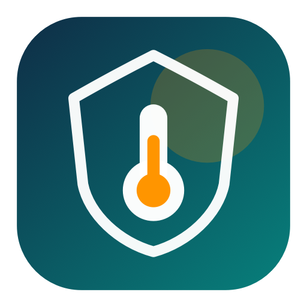
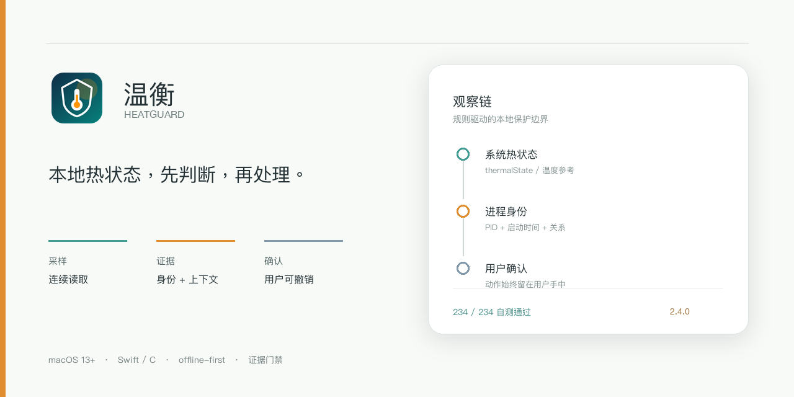
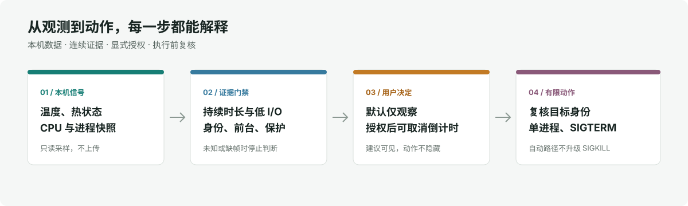

# 温衡 HeatGuard

  

<h2 align="center">本地热状态，先判断，再处理。</h2>

一个把系统热状态、硬件参考、进程身份和用户确认放在同一条观察链里的 macOS 工具。

  

  <a href="#构建与测试">构建与测试</a> ·
  <a href="#已知边界">已知边界</a> ·
  <a href="#项目来源与许可">来源与许可</a>

<table align="center">
  <tr>
    <td><strong>版本</strong> 2.4.0 / build 85</td>
    <td><strong>平台</strong> macOS 13+</td>
    <td><strong>技术</strong> Swift · C · Universal 2</td>
    <td><strong>运行方式</strong> offline-first</td>
  </tr>
</table>

> 温衡是规则驱动的原生 macOS 工具，不是 AI 产品，也没有接入云端模型。界面与处置边界以本仓库代码为准。

## 能力

- 菜单栏常驻，提供硬件温度参考、系统热状态和一键排查。
- 以连续采样、进程身份、前台/近期活动、父进程关系、保护名单和低 I/O/低唤醒证据共同约束处置。
- 默认仅观察。自动结束需要单独开启并授权；常规模式先给 30 秒取消窗口，自动路径只发送 SIGTERM。
- 温和降级前后读取系统调度状态；它只是资源争用时让步，不是 CPU 硬限速。
- 数据留在本机；不需要账号，不读取文档内容或进程命令行参数。

## 设计结构

硬件温度来自实验性的只读 AppleSMC 后端。它不是 Apple 公开承诺稳定的跨机型接口，传感器键或系统版本变化时可能不可用；无法取得可信读数时，依赖温度的自动规则会停止。

## 版本与验证

源码快照对应 2.4.0/build85。该版本在作者的 Apple Silicon Mac 上完成安装后验证；自测 234 项、集成测试 171 项通过，Universal 2 二进制和严格 ad-hoc 签名检查通过。另有一段 180 秒清醒短窗测量，不能代表全天运行、睡眠唤醒或长期功耗。

项目要求 macOS 13 或更新版本。Apple Silicon 路径经过实机验证；Intel 代码路径已覆盖测试，但尚无实体 Intel 机器验收。应用没有 Developer ID 签名或 Apple 公证。

## 构建与测试

需要 macOS、Xcode Command Line Tools 和 Swift 工具链：

~~~sh
./scripts/test.sh
./scripts/build-app.sh
~~~

测试脚本会构建并运行 Swift 自测、集成测试和 C 层测试。构建脚本在仓库内生成候选应用，不安装、不注册登录启动项，也不替用户开启自动处理。

## 已知边界

- 高 CPU、低磁盘活动或温度偏高都不能证明任务没有进展。
- 自动识别用途并不完备；重要工作仍应手动加入保护名单。
- SIGTERM 不保证目标保存数据；手动强制结束会有数据丢失风险。
- 温度阈值是用户偏好，不是硬件损伤标准；本项目不承诺延长硬件寿命。
- 全天稳定性、完整睡眠/锁屏组合、Intel 实机和公证分发仍待验证。

## 项目来源与许可

这是 Leo 发起并持续维护的个人项目，开发过程中使用 AI 编程工具协助实现与测试。温度读取策略参考并保留 macmon v0.8.2 的 MIT 声明，详见 THIRD_PARTY_NOTICES.md。

当前仓库没有 LICENSE 文件，因此源码公开浏览不等于授予复制、修改或分发许可。任何第三方复用前，请先取得权利人许可。
